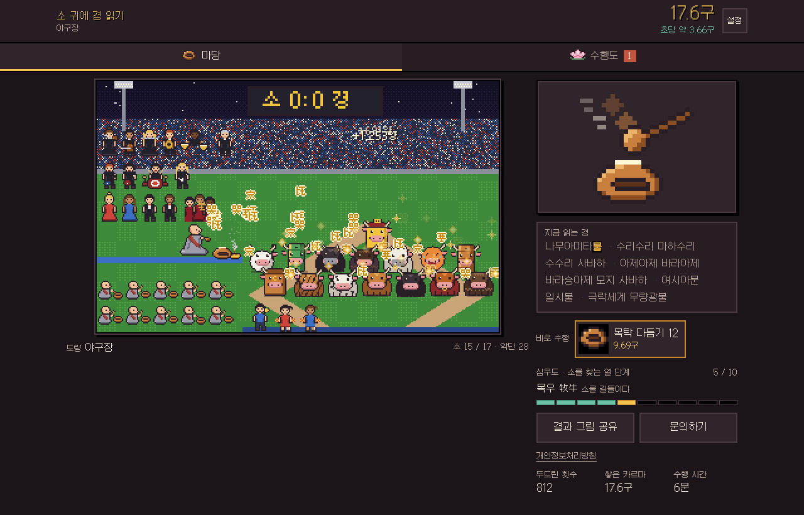
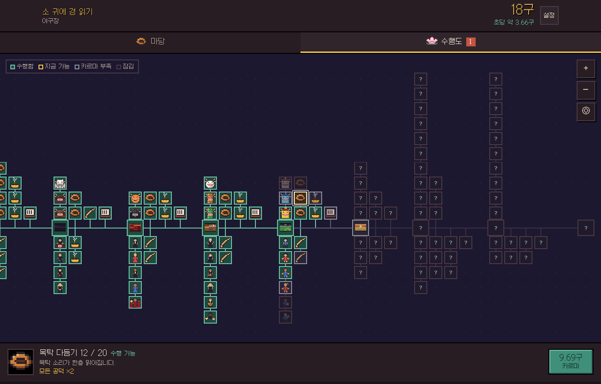

# 소 귀에 경 읽기 (牛耳讀經)

목탁을 두드려 소 귀에 경을 읽어 주는 도트 인크리멘탈 게임입니다.
경은 소의 한쪽 귀로 들어가 반대쪽 귀로 빠져나오고, 그때마다 카르마가 쌓입니다.
카르마로 수행을 쌓아 절간에서 지구까지 법회를 넓히고, 마지막에는 소들을 열반으로 이끕니다.

**바로 플레이:** `index.html` 하나로 돌아갑니다. GitHub Pages를 켜면 `https://<아이디>.github.io/<저장소 이름>/` 주소로 열립니다.



## 하는 법

- 마당 탭에서 목탁 버튼(또는 장면, 스페이스바)을 눌러 목탁을 칩니다.
- 수행도 탭에서 노드를 눌러 카르마로 수행합니다. 끌어서 둘러보고 두 손가락이나 +/− 버튼으로 확대합니다.
- 장소를 옮기면 새 소와 악단이 열립니다. 아직 옮기지 않은 장소의 노드는 `?`로 가려집니다.
- 모든 노드를 수행하고 무량대수 카르마를 바치면 열반 엔딩이 나옵니다. 한 판은 10분 남짓입니다.

## 담긴 것

- **장소 8곳:** 절간 → 콘서트장 → 오페라홀 → 오케스트라홀 → 야구장 → 아프리카 초원 → 서울 → 지구
- **소 41마리:** 누렁소, 칡소, 코뿔소부터 파출소, 세탁소, 수소, 산소, 미소, 흰 소까지 이름이 '소'로 끝나는 모든 것
- **악단 38명:** 동자승, 메탈 밴드, 오페라, 오케스트라, 야구장 응원단, 젬베, 사물놀이가 같은 박자와 화음으로 연주합니다
- **독경:** 경전을 바꿀 때마다 나무아미타불 뒤에 천수경, 반야심경, 금강경 … 화엄경 구절이 이어 붙습니다
- **수행도:** 148개 노드가 장소별 줄기로 뻗은 노드 트리. 향 공양과 귀 청소는 뒤쪽 장소로 갈수록 상위 버전이 됩니다
- **결과 그림 공유:** 지금 장면과 기록으로 PNG 카드를 만들어 저장하거나 휴대폰 공유창(카카오톡 등)으로 보냅니다



## 폴더

| 경로 | 내용 |
| --- | --- |
| `index.html` | 완성된 게임 한 파일 (그림·소리·글꼴이 모두 들어 있음) |
| `assets/aseprite/` | 모든 도트 원본 `.aseprite` (프레임과 애니메이션 태그 포함) |
| `assets/png/` | 같은 그림의 PNG 스프라이트시트 |
| `assets/sound/` | 목탁, 독경 음절, 악기 소리 WAV (모두 합성음) |
| `tools/` | 그림·소리·밸런스·빌드 스크립트와 게임 소스 `game.src.html` |
| `docs/` | 스크린샷, 목탁 합성음과 녹음 비교 그래프 |
| `PRIVACY.md` | 개인정보처리방침 |

## 다시 빌드하기

Python 3.11+와 Node가 필요합니다.

```bash
cd tools
pip install numpy scipy pillow fonttools brotli
npm pack galmuri && tar xzf galmuri-*.tgz          # 갈무리 글꼴 (package/dist)
python3 sound.py && python3 sound2.py              # 소리 합성 → snd/
python3 moktak_model.py                            # 목탁 합성음 → snd/moktak0~2.wav
python3 tune3.py                                   # 노드 배치와 가격 → balance3.json
python3 build_assets2.py                           # 그림·소리 묶음, .aseprite/PNG 내보내기
python3 build_game2.py                             # dist/sogwi.html 생성
cp dist/sogwi.html ../index.html
```

`sim3.py`는 목탁을 초당 몇 번 치느냐에 따라 끝까지 몇 분 걸리는지 확인하는 시뮬레이터입니다.

## 개인정보

게임은 개인정보를 모으지 않습니다. 진행 기록은 플레이하는 브라우저 안(localStorage)에만 저장되고 서버로 보내지 않습니다. 자세한 내용은 [PRIVACY.md](PRIVACY.md)에 있습니다.

## 만든 것과 빌린 것

- 도트 그림과 소리는 모두 이 저장소의 스크립트로 직접 그리고 합성했습니다.
- 글꼴: [갈무리(Galmuri)](https://github.com/quiple/galmuri) © Lee Minseo, SIL Open Font License 1.1 — 게임에 쓰는 글자만 잘라 넣었습니다. 라이선스 전문은 `fonts/Galmuri-OFL.txt`.

## 문의

baramutzero@gmail.com
